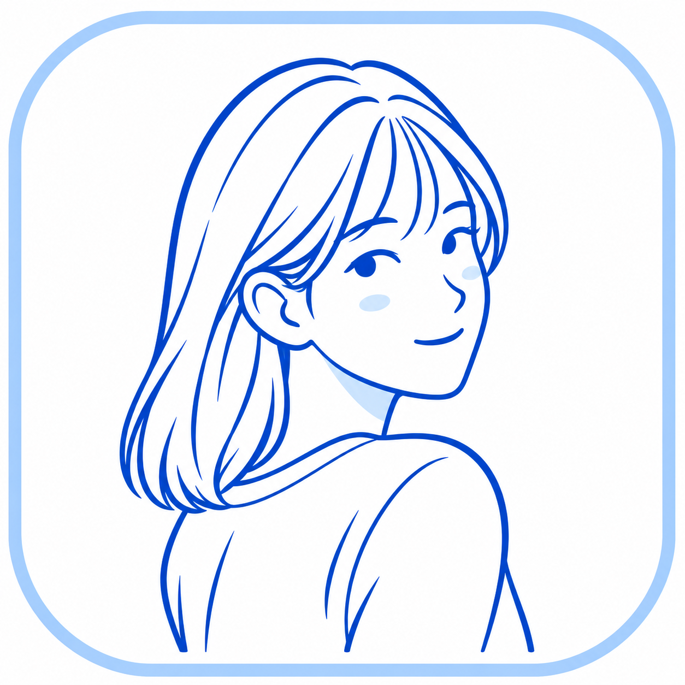

# Illustration Logo Skill

`illustration-logo-skill` is an Agent Skill for creating and refining square illustration marks. It supports calm youthful face outlines, head-and-shoulders portraits, and compact half-body figures with clean graphic linework, varied flat palettes, and one restrained thematic cue inside a rounded-square frame.

The skill is designed for compatible AI agents that can generate raster images. It keeps the artwork simple enough to remain legible at small icon sizes while leaving room for controlled creative variation.



## What it guides

- Three deliberate illustration directions before generation
- Six independent candidates by default, labeled `A1` through `C2`
- Face outlines, head-and-shoulders portraits, and compact half-body figures rather than one fixed pose
- Warm, botanical, sunset, citrus, and rose-dusk palette families instead of an all-blue batch
- One optional thematic cue for reading, making, music, study, nature, travel, or reflection
- A light rounded-square frame and white, cream, blush, ivory, or other quiet field chosen to support the palette
- Broad, confident curves that survive reduction to `32 × 32`
- Quiet editorial warmth instead of photorealistic, glossy, or ornamental rendering
- Separate full-resolution square assets rather than contact sheets
- One-pass delivery of every generated result without automatic ranking or retries
- Clear reporting of direction, palette roles, dimensions, and saved paths

## Use

Ask a compatible AI agent for an illustration direction, for example:

```text
Create six illustration candidates that preserve the current clean line language and 32 × 32 legibility, while mixing face outlines, head-and-shoulders portraits, and compact half-body figures across warm paper, botanical, sunset, citrus studio, and rose-dusk palettes with small thematic cues. Do not make every candidate blue or use the same crop.
```

When the request does not provide enough product context, the skill reads the available workspace context first and asks one consolidated round of questions only when needed. It then proposes three concise directions and waits for approval unless the request already authorizes the batch.

The bundled reference image is a visual anchor for continuity. It is not a requirement to reproduce the exact existing pixels, and it should not be copied into a generated result unless the user explicitly requests a faithful redraw.

## Repository structure

```text
SKILL.md
README.md
LICENSE
assets/illustration-reference.png
```

The skill has no runtime dependencies, scripts, or external style packages.

## License

MIT
